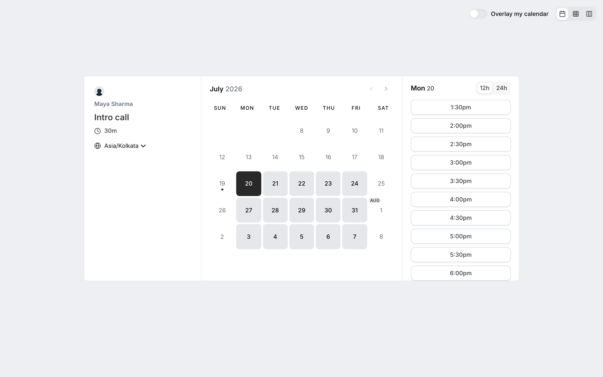

<div align="center">


**Open-source appointment booking for small businesses.** A self-hosted, deliberately smaller edition of Cal.com, built for salons, clinics, consultants and local trades.

[](LICENSE)
[](https://github.com/paypilotlabs/bookyourslot/actions/workflows/ci.yml)
[](https://github.com/sponsors/paypilotlabs)

[Self-hosting](deploy/production/README.md) · [Integrations](docs/APP-STORE.md) · [n8n automations](docs/N8N.md) · [Contributing](CONTRIBUTING.md) · [Security](SECURITY.md)



</div>

## Why BookYourSlot

Cal.com is excellent and large. Most small businesses use a fraction of it and still pay for, or maintain, the rest. BookYourSlot keeps the part a dentist, salon or consultant uses every day and removes the rest: 79 integrations, teams, enterprise SSO and billing are gone. What's left is smaller to run and easier to understand.

New accounts wait for an admin to approve them, so one operator can run a single instance for several businesses.

## What works

- **Booking pages.** Every account gets a public page. Guests pick a time and book without an account.
- **Availability and time zones.** Working hours, date overrides, buffers, minimum notice, and automatic time zone conversion for the guest.
- **Reschedule and cancel.** Guests manage their own booking from the confirmation email.
- **Google Calendar and Meet.** A booking creates a calendar event with a Meet link, a reschedule moves that same event, and existing busy times block slots. Apple Calendar and CalDAV are included but less tested.
- **Email notifications** for confirmations, reschedules and cancellations over SMTP.
- **Reminders at 48h, 24h and 30m** by email. An external scheduler (for example n8n) has to call the reminder route; see [docs/N8N-REMINDERS.md](docs/N8N-REMINDERS.md).
- **Webhooks** (`BOOKING_CREATED`, `BOOKING_RESCHEDULED`, `BOOKING_CANCELLED` and more), the supported path for automations. See [docs/N8N.md](docs/N8N.md).
- **Embeds.** Inline widget, popup or React component for your own site.
- **In-person and phone appointments.** Attendee address, organizer address, custom location, either party's phone, or any link.
- **Booking questions.** Thirteen answer types per service, optionally required.
- **Requires confirmation, seats and recurring bookings.**
- **Admin approval and an admin-only app store.** Businesses can't install integrations themselves; the operator assigns them. Calendar connections stay self-serve because Google requires the account holder's consent.

## What's not included

| Area | Status |
| --- | --- |
| Teams and round-robin | Not available. The schema and engine are still in the code, but there is no UI and `/teams` returns 404. |
| Collective booking | Works: `/alice+bob/30min` books everyone into one appointment at a time they are all free. |
| Workflows engine | Removed. Reminders use the cron route above instead. |
| SMS and WhatsApp messages | Not sent. The WhatsApp, Telegram and Signal apps are location links only. |
| Payments | Not supported. A price on an event type produces bookings that never confirm. |
| Billing, SSO, SAML, SCIM, organizations, impersonation | Removed. |
| REST API (`apps/api/v2`) | In the repo, not in the Docker build. Use webhooks. |
| Outlook / Microsoft 365 | Removed. |
| Cal Video | Needs `DAILY_API_KEY`; without it, use Google Meet. |

Integrations went from 105 to 26 in the tree, 19 of which appear in the store. [docs/APP-STORE.md](docs/APP-STORE.md) lists each one and what it needs.

## Integrations and the keys they need

Apps that need **no keys** work as shipped: Apple Calendar, CalDAV, n8n,
Pipedream, QR code, the messaging link apps, and the three analytics apps
(tracking IDs are entered per event type, not globally).

Apps that need server credentials in `deploy/production/.env`:

| App | Environment variables |
| --- | --- |
| Google Calendar and Meet | `GOOGLE_API_CREDENTIALS`, `GOOGLE_LOGIN_ENABLED=true` |
| Cal Video | `DAILY_API_KEY` |
| Zoom | `ZOOM_CLIENT_ID`, `ZOOM_CLIENT_SECRET` |
| Stripe | `STRIPE_CLIENT_ID`, `STRIPE_PRIVATE_KEY`, `NEXT_PUBLIC_STRIPE_PUBLIC_KEY`, `STRIPE_WEBHOOK_SECRET`, `PAYMENT_FEE_FIXED`, `PAYMENT_FEE_PERCENTAGE` (all six or none) |
| HubSpot | `HUBSPOT_CLIENT_ID`, `HUBSPOT_CLIENT_SECRET` |
| Salesforce | `SALESFORCE_CONSUMER_KEY`, `SALESFORCE_CONSUMER_SECRET` |
| Zapier | `ZAPIER_INVITE_LINK` |
| Make | `MAKE_INVITE_LINK` |

Keys are read by `scripts/seed-app-store.ts` at container boot, so adding one
requires a redeploy to take effect. An app whose schema requires keys stays
disabled and invisible in the store until they validate.

## Local development

Node 20 and Yarn 4.12 or newer:

```bash
yarn
cp .env.example .env      # set DATABASE_URL, NEXTAUTH_SECRET, CALENDSO_ENCRYPTION_KEY
yarn workspace @calcom/prisma db-migrate
yarn dev                  # http://localhost:3000
```

Before pushing:

```bash
yarn type-check:ci --force
TZ=UTC yarn test
yarn biome check --write .
```

Engineering standards are in [CLAUDE.md](CLAUDE.md) and [agents/](agents/).

## Self-hosting

The reference deployment is one VPS running Docker Compose behind Traefik, with the image built by GitHub Actions and pulled from GHCR.

- [deploy/production/README.md](deploy/production/README.md): DNS, first boot, SMTP, OAuth, updates, rollback
- [docs/DEPLOYMENT-AUTOMATION.md](docs/DEPLOYMENT-AUTOMATION.md): the CI/CD pipeline and its security model
- [deploy/production/CHECKLIST.md](deploy/production/CHECKLIST.md): launch checklist
- [docs/OPS-RUNBOOK.md](docs/OPS-RUNBOOK.md): backups, cron and day-to-day operations

Four things that will cost you data if ignored:

- **Never rotate `CALENDSO_ENCRYPTION_KEY` after go-live.** Every stored
  calendar credential is encrypted with it and becomes unreadable. Keep a copy
  somewhere other than the VPS — it is not in git, not in GitHub secrets, and not
  in the database dumps, so without it a restore onto a fresh box is useless.
- **Never run `docker compose down -v` in production.** The `-v` deletes the
  `database-data` volume. Plain `down` is safe.
- **Merging a change under `deploy/` does nothing on its own.** `docker-compose.yml`
  and `remote-deploy.sh` are read from the host checkout at `/opt/bookyourslot`,
  not from the image, and nothing updates it automatically. `git pull --ff-only
  origin main` on the VPS, then redeploy. This has silently swallowed two fixes.
- **The `emails` feature flag is an inverted kill switch.** `enabled = true` stops
  all outbound email with only a `console.warn`. It must stay `false`.

### Standing checks after a deploy

Google integration failure is silent here: the key lookup throws outside the
calendar service's try block, so a broken calendar shows up only in the database.
A booking still saves and the customer still gets a "confirmed" email.

```sql
-- Bookings that got a confirmation but never reached a calendar.
SELECT count(*) FROM "BookingReference"
WHERE type = 'google_calendar' AND (uid = '' OR uid IS NULL);
```

Anything above the known historical count means a real customer was affected.

### Admin tasks

| Task | Where |
| --- | --- |
| Approve a pending business | Settings → Admin → Users (pending count shows in the sidebar) |
| Enable or configure an app | Settings → Admin → Apps |
| Feature flags | Settings → Admin → Features |

## More documentation

- [docs/TESTING.md](docs/TESTING.md): testing locally and on a server
- [docs/GITHUB.md](docs/GITHUB.md): branching, pull requests and secrets policy
- [docs/BACKLOG.md](docs/BACKLOG.md): known gaps and planned reliability work
- [docs/FEATURE-LEDGER.md](docs/FEATURE-LEDGER.md): what was kept and removed from Cal.com

## Contributing and support

Issues and pull requests are welcome; read [CONTRIBUTING.md](CONTRIBUTING.md). Report security problems privately, see [SECURITY.md](SECURITY.md).

Want BookYourSlot run for you instead of hosting it yourself? [PayPilotLabs](https://paypilotlabs.com) offers managed hosting and setup.

If BookYourSlot is useful to you, [sponsoring PayPilotLabs](https://github.com/sponsors/paypilotlabs) keeps it maintained.

## License and attribution

MIT, see [LICENSE](LICENSE). Built and maintained by Lohith Kumar Nerukonda at [PayPilotLabs](https://github.com/paypilotlabs), on top of [Cal.com](https://github.com/calcom/cal.com)'s open-source edition. Thanks to the Cal.com team and contributors.
