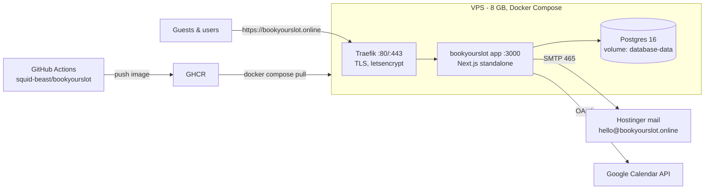

# BookYourSlot — production runbook

Everything needed to run bookyourslot.online on a single 8 GB VPS with Docker
Compose, behind the **Traefik** that already runs on the box and terminates TLS.
GitHub is the source of truth.

There are two ways the image gets onto the server:

- **Automatic (normal).** Merging to `main` builds the image in GitHub Actions,
  pushes it to GHCR, and deploys it over SSH. See
  [docs/DEPLOYMENT-AUTOMATION.md](../../docs/DEPLOYMENT-AUTOMATION.md).
- **Manual (first boot, or when CI is unavailable).** The server builds from the
  source tree with `./deploy.sh`, which is what sections 3 and 4 below describe.

## Architecture



- **Traefik is not part of this compose file.** It already runs on the host and
  is the only thing publishing 80/443. The app and DB publish no ports at all;
  Traefik reaches the app over the `bys` bridge network using the router labels
  on the `bookyourslot` service (router name `bys`, backend port 3000).
- Migrations + a safe app-store seed run automatically on every app boot
  (`scripts/start.sh`). **Never run `yarn db-seed` in production** — it creates
  demo users with guessable passwords.

## 1. DNS (do first — Traefik needs it to issue certificates)

| Record | Host  | Value        |
| ------ | ----- | ------------ |
| A      | `@`   | your VPS IP  |
| CNAME  | `www` | `bookyourslot.online` |

## 2. Server preparation (Ubuntu 22.04/24.04)

```bash
# Docker Engine + compose plugin
curl -fsSL https://get.docker.com | sh

# Firewall: SSH + web only
ufw allow 22 && ufw allow 80 && ufw allow 443 && ufw --force enable

# 4 GB swap — the image build caps its heap at 4 GB, which is tight on an
# 8 GB box while the stack is running. Swap makes builds boring instead of fatal.
fallocate -l 4G /swapfile && chmod 600 /swapfile && mkswap /swapfile && swapon /swapfile
echo '/swapfile none swap sw 0 0' >> /etc/fstab
```

## 3. Clone + configure

```bash
git clone https://github.com/squid-beast/bookyourslot.git /opt/bookyourslot
cd /opt/bookyourslot/deploy/production
cp .env.production.example .env
nano .env    # fill every <PLACEHOLDER> — secrets, DB password, SMTP password
```

Licensed brand fonts are gitignored, so copy them from your machine before the
first build (logo/favicon images work without this, but the web font needs it):

```bash
scp apps/web/public/fonts/brand/*.otf apps/web/public/fonts/brand/*.woff2 \
  root@<VPS_IP>:/opt/bookyourslot/apps/web/public/fonts/brand/ 2>/dev/null || true
```

## 4. First build + start

```bash
docker compose build bookyourslot   # 20-40 min the first time
docker compose up -d
docker compose logs -f bookyourslot # wait for "ready" + migration output
```

Visit `https://bookyourslot.online` — the landing page should load with a valid
certificate. `https://www.bookyourslot.online` serves the same app rather than
redirecting: the Traefik router matches both hosts, and the canonical tags in the
page handle the SEO side. Add a www-to-apex redirect middleware in Traefik only
if you decide the duplicate host matters.

## 5. First boot: create your admin

Open **`https://bookyourslot.online/auth/login`** — with zero users in the
database it redirects to `/auth/setup`, which creates the admin account. Use a
strong password; this account manages apps and settings.

Do this before announcing the domain. `/auth/setup` is open to anonymous
visitors only while the user table is empty, precisely so the first admin can be
created; once any user exists it returns 404 to everyone but an admin.

## 5a. Approving new businesses

Self-serve signups are created **pending** and cannot sign in until you approve
them. As admin, go to **Settings, Admin, Users**; the pending count appears as a
badge in the sidebar. Unlocking an account approves it and sends that business
its verification email.

## 6. Back the landing-page demo link

The landing hero links to **`/demo/30min`**. Make it real:

1. Sign up a user with username **`demo`** (use an alias like
   `hello+demo@bookyourslot.online`).
2. Ensure it has a 30-minute event type with slug **`30min`** (rename the
   default or create one titled e.g. "Intro call") and a sensible schedule.
3. Open `https://bookyourslot.online/demo/30min` in a private window — the
   booker should show slots.

## 7. Email (already configured via .env)

Prove it end to end: book the demo event from a private window using an
external address (Gmail etc.) and confirm both confirmation emails arrive.
If nothing arrives, `docker compose logs bookyourslot | grep -i mail` — the usual
cause is an unset/wrong `EMAIL_SERVER_PASSWORD`.

## 8. Google Calendar OAuth

1. [console.cloud.google.com](https://console.cloud.google.com) → new project
   → enable **Google Calendar API**.
2. OAuth consent screen: External, app name BookYourSlot, your domain,
   publish to production (or add yourself as a test user meanwhile).
3. Credentials → Create OAuth client → **Web application** → authorized
   redirect URI, exactly:
   `https://bookyourslot.online/api/integrations/googlecalendar/callback`
4. Put the client JSON (one line) into `GOOGLE_API_CREDENTIALS` in `.env`,
   then `docker compose up -d bookyourslot` to restart.
5. Log in as admin → Settings → Admin → Apps → enable **Google Calendar**.
6. Verify: connect your own Google account from Settings → Apps, book the
   demo event, and check it lands on the calendar.

## 9. Get found (SEO / AEO / GEO)

Indexing is earned over days–weeks; these steps start the clock:

1. [Google Search Console](https://search.google.com/search-console): add
   property `bookyourslot.online` (DNS TXT verification), submit
   `https://bookyourslot.online/sitemap.xml`, then **URL Inspection → Request
   indexing** for `/` and each `/blog/...` post.
2. [Bing Webmaster Tools](https://www.bing.com/webmasters): import from
   Search Console (one click) — also feeds DuckDuckGo and several AI crawlers.
3. Validate structured data on `/` and one blog post with
   [Google's Rich Results Test](https://search.google.com/test/rich-results)
   (expect FAQPage, SoftwareApplication, BlogPosting).
4. `https://bookyourslot.online/llms.txt` serves the AI-crawler summary; the
   FAQ on the landing page is the answer-engine surface. Nothing else to do.

## 10. Go-live checklist

- [ ] `https://bookyourslot.online` loads with valid TLS; `www.` serves the app
- [ ] Admin account created via `/auth/setup`; no demo users seeded
- [ ] `demo` user + `/demo/30min` books end-to-end from a private window
- [ ] Confirmation emails arrive at an external address
- [ ] Google Calendar connects and receives a test booking
- [ ] `/sitemap.xml`, `/robots.txt`, `/llms.txt`, `/og-image.png` all respond
- [ ] Search Console verified + sitemap submitted
- [ ] `ORGANIZATIONS_ENABLED` is empty in `.env`

## Updating

Normally you do nothing: merging to `main` deploys automatically. To build on
the server instead:

```bash
cd /opt/bookyourslot/deploy/production && ./deploy.sh
```

If a rebuild ever OOMs while the stack is running:
`docker compose stop bookyourslot && docker compose build bookyourslot && docker compose up -d`.

**One time only, on the first deploy that carries the 3.0.0 rename:** the compose
service was renamed from `calcom` to `bookyourslot`, so a plain `up -d` leaves the
old `production-calcom-1` container running alongside the new one and Traefik may
keep routing to the stale one. Run this once:

```bash
cd /opt/bookyourslot/deploy/production && docker compose down && docker compose up -d
```

`down` without `-v` stops and removes containers but keeps the `database-data`
volume. **Never add `-v`.** It deletes the database.

## Backups (recommended)

Create the directory once, before adding the job:

```bash
mkdir -p /root/backups
```

```bash
# Nightly dump, keep 14 days — add via `crontab -e`:
0 3 * * * cd /opt/bookyourslot/deploy/production && bash -o pipefail -c 'docker compose exec -T database pg_dump --clean --if-exists -U bookyourslot bookyourslot | gzip > /root/backups/bys-$(date +\%F).sql.gz.part' && mv /root/backups/bys-$(date +\%F).sql.gz.part /root/backups/bys-$(date +\%F).sql.gz && find /root/backups -name 'bys-*.sql.gz' -mtime +14 -delete
```

Three details that matter, each of which cost a working backup in the previous
version of this line:

- **`mkdir -p` first.** The redirection cannot create `/root/backups`. Without it
  the job fails every night, and cron's only complaint goes to root's local mail
  on a box with no mail reader.
- **`bash -o pipefail`.** cron runs `/bin/sh`, where a pipeline's exit status is
  gzip's, not `pg_dump`'s. A failed dump still produces a valid, empty `.gz`, and
  the `&&` still fires.
- **`.part` then `mv`.** The dated filename only appears once the dump finished,
  so a half-written file can never be mistaken for a good one, and the `find`
  prune cannot delete real history and leave you with empties.

`/root` is the same disk as the Postgres volume, so this survives a bad deploy but
not a dead disk. Copying the newest file offsite (`scp`, `rclone`) is the next
step.

Test the restore before you need it, on a scratch database. An untested backup is
a guess.

## Troubleshooting

| Symptom | Fix |
| --- | --- |
| Login loops / `CLIENT_FETCH_ERROR` | `NEXTAUTH_URL` must be `https://bookyourslot.online` |
| No emails | SMTP vars unset/wrong → app silently falls back to a MailHog that doesn't exist. Check `EMAIL_SERVER_*` |
| Certificate not issued | DNS not propagated yet, or port 80/443 blocked — check the Traefik container's own logs |
| Traefik returns 404 for the domain | The app is not on the `bys` network, or the router labels were changed. `docker network inspect bys` should list both Traefik and `bookyourslot` |
| `/username` pages behave oddly | Ensure `ORGANIZATIONS_ENABLED` is empty (apex-domain rewrite hazard) |
| Calendar connections broken after env change | You rotated `CALENDSO_ENCRYPTION_KEY` — restore the old value; reconnect calendars |
