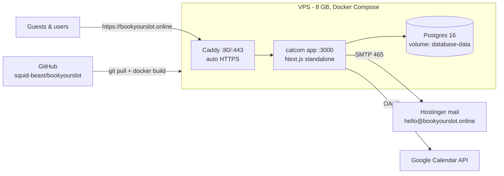

# BookYourSlot — production runbook

Everything needed to run bookyourslot.online on a single 8 GB VPS with Docker
Compose and Caddy (automatic HTTPS). GitHub is the source of truth; the server
builds the image itself.

## Architecture



- Only Caddy publishes ports (80/443). App and DB live on the internal network.
- Migrations + a safe app-store seed run automatically on every app boot
  (`scripts/start.sh`). **Never run `yarn db-seed` in production** — it creates
  demo users with guessable passwords.

## 1. DNS (do first — Caddy needs it to issue certificates)

| Record | Host  | Value        |
| ------ | ----- | ------------ |
| A      | `@`   | your VPS IP  |
| CNAME  | `www` | `bookyourslot.online` |

## 2. Server preparation (Ubuntu 22.04/24.04)

```bash
# Docker Engine + compose plugin
curl -fsSL https://get.docker.com | sh

# Firewall: SSH + web only
ufw allow 22 && ufw allow 80 && ufw allow 443 && ufw --force enable

# 4 GB swap — the image build caps its heap at 4 GB, which is tight on an
# 8 GB box while the stack is running. Swap makes builds boring instead of fatal.
fallocate -l 4G /swapfile && chmod 600 /swapfile && mkswap /swapfile && swapon /swapfile
echo '/swapfile none swap sw 0 0' >> /etc/fstab
```

## 3. Clone + configure

```bash
git clone https://github.com/squid-beast/bookyourslot.git /opt/bookyourslot
cd /opt/bookyourslot/deploy/production
cp .env.production.example .env
nano .env    # fill every <PLACEHOLDER> — secrets, DB password, SMTP password
```

## 4. First build + start

```bash
docker compose build calcom   # 20-40 min the first time
docker compose up -d
docker compose logs -f calcom # wait for "ready" + migration output
```

Visit `https://bookyourslot.online` — the landing page should load with a valid
certificate, and `https://www.bookyourslot.online` should redirect to the apex.

## 5. First boot: create your admin

Open **`https://bookyourslot.online/auth/login`** — with zero users in the
database it redirects to `/auth/setup`, which creates the admin account. Use a
strong password; this account manages apps and settings.

## 6. Back the landing-page demo link

The landing hero links to **`/demo/30min`**. Make it real:

1. Sign up a user with username **`demo`** (use an alias like
   `hello+demo@bookyourslot.online`).
2. Ensure it has a 30-minute event type with slug **`30min`** (rename the
   default or create one titled e.g. "Intro call") and a sensible schedule.
3. Open `https://bookyourslot.online/demo/30min` in a private window — the
   booker should show slots.

## 7. Email (already configured via .env)

Prove it end to end: book the demo event from a private window using an
external address (Gmail etc.) and confirm both confirmation emails arrive.
If nothing arrives, `docker compose logs calcom | grep -i mail` — the usual
cause is an unset/wrong `EMAIL_SERVER_PASSWORD`.

## 8. Google Calendar OAuth

1. [console.cloud.google.com](https://console.cloud.google.com) → new project
   → enable **Google Calendar API**.
2. OAuth consent screen: External, app name BookYourSlot, your domain,
   publish to production (or add yourself as a test user meanwhile).
3. Credentials → Create OAuth client → **Web application** → authorized
   redirect URI, exactly:
   `https://bookyourslot.online/api/integrations/googlecalendar/callback`
4. Put the client JSON (one line) into `GOOGLE_API_CREDENTIALS` in `.env`,
   then `docker compose up -d calcom` to restart.
5. Log in as admin → Settings → Admin → Apps → enable **Google Calendar**.
6. Verify: connect your own Google account from Settings → Apps, book the
   demo event, and check it lands on the calendar.

## 9. Get found (SEO / AEO / GEO)

Indexing is earned over days–weeks; these steps start the clock:

1. [Google Search Console](https://search.google.com/search-console): add
   property `bookyourslot.online` (DNS TXT verification), submit
   `https://bookyourslot.online/sitemap.xml`, then **URL Inspection → Request
   indexing** for `/` and each `/blog/...` post.
2. [Bing Webmaster Tools](https://www.bing.com/webmasters): import from
   Search Console (one click) — also feeds DuckDuckGo and several AI crawlers.
3. Validate structured data on `/` and one blog post with
   [Google's Rich Results Test](https://search.google.com/test/rich-results)
   (expect FAQPage, SoftwareApplication, BlogPosting).
4. `https://bookyourslot.online/llms.txt` serves the AI-crawler summary; the
   FAQ on the landing page is the answer-engine surface. Nothing else to do.

## 10. Go-live checklist

- [ ] `https://bookyourslot.online` loads with valid TLS; `www.` redirects
- [ ] Admin account created via `/auth/setup`; no demo users seeded
- [ ] `demo` user + `/demo/30min` books end-to-end from a private window
- [ ] Confirmation emails arrive at an external address
- [ ] Google Calendar connects and receives a test booking
- [ ] `/sitemap.xml`, `/robots.txt`, `/llms.txt`, `/og-image.png` all respond
- [ ] Search Console verified + sitemap submitted
- [ ] `ORGANIZATIONS_ENABLED` is empty in `.env`

## Updating

```bash
cd /opt/bookyourslot/deploy/production && ./deploy.sh
```

If a rebuild ever OOMs while the stack is running:
`docker compose stop calcom && docker compose build calcom && docker compose up -d`.

## Backups (recommended)

```bash
# Nightly dump, keep 14 days — add via `crontab -e`:
0 3 * * * cd /opt/bookyourslot/deploy/production && docker compose exec -T database pg_dump -U bookyourslot bookyourslot | gzip > /root/backups/bys-$(date +\%F).sql.gz && find /root/backups -mtime +14 -delete
```

## Troubleshooting

| Symptom | Fix |
| --- | --- |
| Login loops / `CLIENT_FETCH_ERROR` | `NEXTAUTH_URL` must be `https://bookyourslot.online` |
| No emails | SMTP vars unset/wrong → app silently falls back to a MailHog that doesn't exist. Check `EMAIL_SERVER_*` |
| Certificate not issued | DNS not propagated yet, or port 80/443 blocked — check `docker compose logs caddy` |
| `/username` pages behave oddly | Ensure `ORGANIZATIONS_ENABLED` is empty (apex-domain rewrite hazard) |
| Calendar connections broken after env change | You rotated `CALENDSO_ENCRYPTION_KEY` — restore the old value; reconnect calendars |
