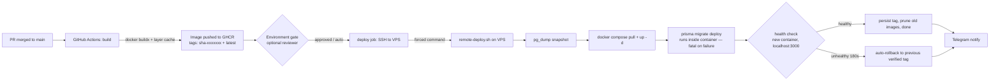

# BookYourSlot — automated deployment (CI/CD)

Merge to `main` → GitHub builds a secret-free image → the VPS pulls it and
cuts over in seconds, with a health gate and automatic rollback. This document
is the complete setup and operations guide, written for **security first**,
then organization capability and performance.

- **Workflow:** [`.github/workflows/deploy.yml`](../.github/workflows/deploy.yml)
- **Server script:** [`deploy/production/remote-deploy.sh`](../deploy/production/remote-deploy.sh)
- **Registry overlay:** [`deploy/production/docker-compose.registry.yml`](../deploy/production/docker-compose.registry.yml)
- **VPS setup:** [`deploy/production/setup-deploy-user.sh`](../deploy/production/setup-deploy-user.sh)
- **Repo policies (branch protection):** [docs/GITHUB.md](GITHUB.md)

---

## 1. How it works



**Why build in CI instead of on the server** — three properties of this
codebase make it not just possible but clearly better:

1. **The image carries no secrets.** The Dockerfile defaults `NEXTAUTH_SECRET`
   and `CALENDSO_ENCRYPTION_KEY` to the literal `secret`; the app reads the real
   values at **runtime** from the container env. The build never needs them, so
   they never touch the image or the registry.
2. **One image runs anywhere.** `NEXT_PUBLIC_WEBAPP_URL` is baked as a
   placeholder and `scripts/start.sh` rewrites it at boot. The same artifact you
   built is the artifact you run — no per-server rebuild.
3. **Migrations are automatic.** `start.sh` runs `prisma migrate deploy` (and
   the app-store seed) on every boot, so a pulled image self-migrates. Migrations
   are forward-only and additive; your data is never reset (see
   [§8](#8-database-safety)).

The result: the production server does **zero build work**, holds **no build
secrets**, and a deploy is a `pull` + `up` measured in seconds. Rollback is
re-pulling a previous tag.

---

## 2. Security model

The design assumes the GitHub runner, the network, and even a leaked deploy key
are all potentially hostile, and limits the blast radius of each.

| Layer | Control | What it stops |
| --- | --- | --- |
| Token scope | Workflow `permissions: {}`; jobs grant only `contents: read` / `packages: write` | A compromised step can't touch repo settings, secrets, or other repos |
| Build secrets | None passed to the build; real secrets live only in the VPS `.env` | Registry or image exposure leaks nothing usable |
| Registry | GHCR package kept **private**; VPS pulls with a `read:packages`-only token | Public can't pull your app image; VPS token can't push or modify |
| SSH identity | Dedicated ed25519 key, used by nothing else, shredded after each run | Key reuse; lingering credentials on the runner |
| SSH authority | Server **forces one command** (`remote-deploy.sh`) via `authorized_keys`; `no-pty`, `restrict` | A leaked key gets no shell — only `deploy`/`rollback` |
| Command integrity | `remote-deploy.sh` validates `SSH_ORIGINAL_COMMAND` against `^(deploy\|rollback) (latest\|sha-[0-9a-f]{7,40})$` | Command injection through the tag argument |
| Host identity | `DEPLOY_KNOWN_HOSTS` pins the server key; `StrictHostKeyChecking=yes` | Man-in-the-middle / rogue host |
| Privilege | Deploy runs as a non-root `deploy` user | SSH foothold isn't instant root |
| Approval | `environment: production` supports required reviewers (UI toggle) | Unreviewed or accidental production changes |
| Concurrency | `deploy-production` group, `cancel-in-progress: false` | Two deploys colliding / a half-applied cutover |
| Supply chain | Actions pinned to SHAs + Dependabot ([§9](#9-supply-chain-hardening)) | A hijacked action tag running as you |

**What a leaked `DEPLOY_SSH_KEY` can do:** trigger a deploy or rollback of an
existing, validated image tag. **What it cannot do:** open a shell, run any
other command, forward ports, read files, or reach the database directly.

**What a compromised GitHub run can do:** push an image and ask the server to
run it. This is the irreducible trust of "auto-deploy on merge" — which is why
branch protection (required PR + review + CI) in [GITHUB.md](GITHUB.md) is part
of this security model, and why you can add a required reviewer on the
`production` environment for a second gate.

---

## 3. Prerequisites

- Repo on GitHub: `github.com/paypilotlabs/bookyourslot`, CI green.
- VPS reachable over SSH, repo cloned at `/opt/bookyourslot`, Docker + compose
  plugin installed, the stack already brought up once by hand per
  [deploy/production/README.md](../deploy/production/README.md).
- `deploy/production/.env` filled in on the VPS (never committed).

---

## 4. One-time setup

Six steps. Do them in order; the first deploy proves them.

### 4.1 Generate the dedicated deploy key (on your laptop)

```bash
ssh-keygen -t ed25519 -C "deploy@bookyourslot" -f ./bys_deploy -N ""
# creates bys_deploy (private) and bys_deploy.pub (public)
```

### 4.2 Create the locked-down deploy user (on the VPS, as root)

```bash
cd /opt/bookyourslot
sudo bash deploy/production/setup-deploy-user.sh "$(cat /path/to/bys_deploy.pub)"
```

This creates the `deploy` user, adds it to the `docker` group, and pins the
public key to the forced command. It prints the remaining sub-steps.

### 4.3 Let the VPS pull the private image

Create a **Personal Access Token (classic)** with **`read:packages` only**
(GitHub → Settings → Developer settings → Personal access tokens → Tokens
(classic)).

It must be a **classic** token. GHCR does not accept fine-grained tokens:
"GitHub Packages only supports authentication using a personal access token
(classic)." A fine-grained token authenticates against the API but is refused by
the container registry, so `docker compose pull` fails with `denied`.

Set the expiration to **No expiration**. This credential exists only so an
unattended VPS can pull one private image, and there is nothing to rotate it
automatically - when it lapses the next deploy fails at the pull step with
`denied`, while the running container keeps serving, so the breakage is silent
until the next release. `read:packages` cannot push, delete, or read code. If
you would rather set a date, put a calendar reminder a week before it, because
nothing else will warn you.

(GitHub deletes tokens unused for a year on its own. This one is used on every
deploy, so that never triggers.)

Then, on the VPS - typed at a prompt rather than passed on the command line, so
it stays out of shell history:

```bash
read -rs GHCR_TOKEN && printf '%s' "$GHCR_TOKEN" | sudo -u deploy -H docker login ghcr.io -u <github-user> --password-stdin && unset GHCR_TOKEN
```

The `-H` matters: the credential is written to the invoking user's
`~/.docker/config.json`, and the deploy runs as `deploy`, so it has to land in
`/home/deploy/.docker/config.json`.

Verify it took, without pulling any layers:

```bash
sudo -u deploy -H docker manifest inspect ghcr.io/paypilotlabs/bookyourslot:latest >/dev/null && echo "GHCR auth OK"
```

Keep the GHCR package **private** (Package settings → change visibility).

### 4.4 Capture the host key for pinning (on your laptop)

```bash
ssh-keyscan -t ed25519 <VPS-IP-or-host> 2>/dev/null
# copy the whole output line — this is DEPLOY_KNOWN_HOSTS
```

### 4.5 Add GitHub repo secrets

Repo → Settings → Secrets and variables → Actions → **New repository secret**:

| Secret | Value |
| --- | --- |
| `DEPLOY_SSH_KEY` | contents of `bys_deploy` (the **private** key) |
| `DEPLOY_HOST` | VPS IP or hostname |
| `DEPLOY_USER` | `deploy` |
| `DEPLOY_KNOWN_HOSTS` | the `ssh-keyscan` line from 4.4 |
| `TELEGRAM_BOT_TOKEN` | *(optional)* bot token for deploy pings |
| `TELEGRAM_CHAT_ID` | *(optional)* your chat id |

Delete `bys_deploy`/`bys_deploy.pub` from your laptop once the secret is saved.

### 4.6 Create the `production` environment

Repo → Settings → **Environments** → New environment → `production`. Leave it
open for **auto-deploy on merge** (your stated goal), or add **Required
reviewers = you** and **Deployment branches = `main` only** for an approval gate
— no workflow edit needed either way.

### 4.7 Cut the VPS over to image-based runs

The automation runs the stack with the registry overlay. After the first CI
image exists (step 5), switch the server so manual restarts also use it:

```bash
# on the VPS, in deploy/production/, after CI has pushed at least one image
git pull --ff-only
echo "IMAGE_TAG=latest" >> .env      # remote-deploy.sh manages this afterwards
docker compose -f docker-compose.yml -f docker-compose.registry.yml pull bookyourslot
docker compose -f docker-compose.yml -f docker-compose.registry.yml up -d
```

Until you do this, your existing build-on-server flow
([deploy.sh](../deploy/production/deploy.sh)) still works unchanged.

---

## 5. The first deploy

1. Merge any small PR to `main` (or run **Actions → Deploy → Run workflow**).
2. Watch **Actions**: `build` pushes `ghcr.io/paypilotlabs/bookyourslot:sha-…`,
   then `deploy` SSHes in and cuts over.
3. `remote-deploy.sh` snapshots the DB, pulls, `up -d`, waits for the new
   container to answer on `localhost:3000`, persists the verified tag, prunes,
   and reports.
4. If configured, Telegram pings you the result.

First build is ~30–40 min (cold cache); later builds are typically ~5–10 min.

---

## 6. Operating it

> **One-time step when you first deploy the service rename.** The compose
> service was renamed from `calcom` to `bookyourslot`, so the old
> `production-calcom-1` container is now an orphan that a plain `up -d` leaves
> running. On the first deploy after this change only, run:
>
> ```bash
> cd /opt/bookyourslot/deploy/production
> docker compose down
> docker compose -f docker-compose.yml -f docker-compose.registry.yml up -d
> ```
>
> `docker compose down` stops and removes containers but **not** volumes, so the
> `database-data` volume and all your bookings are untouched. Never add `-v`.

**Ship a change** — merge to `main`. That's the whole workflow.

**Roll back** — Actions → **Deploy** → Run workflow → set `image_tag` to a known
good tag (e.g. `sha-abc1234`, visible in GHCR or prior run logs). It skips the
build and redeploys that image in seconds. Rollback reverts the **image only**,
not the database — see [§8](#8-database-safety).

> **First deploy has no rollback target.** Before the first CI image existed
> there was nothing in the registry to fall back to, so if the very first
> automated deploy is unhealthy the script leaves the new container running and
> reports "no reliable previous image" — fix forward or revert the merge. From
> the second deploy on, rollback targets the previous health-verified `sha-…`.

**See what's live** — the running tag is in `deploy/production/.env`
(`IMAGE_TAG=`) and in the repo's **Environments → production** deployment
history.

**Read logs** — on the VPS:
`docker compose -f docker-compose.yml -f docker-compose.registry.yml logs -f bookyourslot`.

**Restore a DB snapshot** — snapshots are in `/opt/bookyourslot/backups/`
(`pre-deploy-*.sql.gz`, last 7 kept):

```bash
cd /opt/bookyourslot/deploy/production
COMPOSE="docker compose -f docker-compose.yml -f docker-compose.registry.yml"

# Stop the app first: open connections block the DROPs, and you do not want
# writes landing mid-restore.
$COMPOSE stop bookyourslot

gunzip -c backups/pre-deploy-<ts>.sql.gz | \
  $COMPOSE exec -T database \
  psql -v ON_ERROR_STOP=1 --single-transaction -U bookyourslot -d bookyourslot

$COMPOSE up -d bookyourslot
```

`ON_ERROR_STOP=1` and `--single-transaction` are not optional. Without them psql
reports success no matter what happened: every `CREATE` fails with "already
exists", every `COPY` fails on the primary key, and the exit code is still 0. You
would read that as a successful restore. Snapshots are taken with
`pg_dump --clean --if-exists`, so the `DROP` statements are safe against an empty
database too.

---

## 7. Performance

- **Build once, deploy many.** The server never builds; cutover is a pull + a
  container swap (seconds), not a 20–40 min rebuild competing with live traffic.
- **Layer caching.** `cache-from/to: type=gha, mode=max` keeps warm layers
  between runs, so only changed layers rebuild.
- **Right-sized migrations.** `prisma migrate deploy` applies only new
  migrations; no schema work when there aren't any.
- **GitHub minutes budget.** A cold build burns ~30–40 runner-minutes; cached
  builds far less. If you merge often and want faster/cheaper builds, use a
  larger GitHub runner or a dedicated self-hosted build box (never the prod VPS,
  and never for public-fork PRs).
- **Cutover downtime** is the container restart window (~10–30 s) while Traefik
  re-points to the new healthy container. For true zero-downtime, run two
  replicas behind Traefik with backward-compatible migrations — deferred on
  purpose ([§10](#10-optional-hardening--upgrades)); a brief, scheduled blip is
  an honest trade for a single-VPS setup.

---

## 8. Database safety

- Postgres data lives in the `database-data` Docker volume — **untouched** by
  builds, pulls, and container recreation. Only `docker compose down -v` or
  deleting the volume destroys it; the pipeline never does that.
- Every deploy takes a `pg_dump` snapshot **before** cutover (last 7 kept in
  `/opt/bookyourslot/backups/`). The snapshot path is printed in the deploy log
  and in any failure message.

**Auto-rollback reverts code, never the database — this is the one sharp edge.**
`start.sh` runs `prisma migrate deploy` as the new container boots, so a release
that ships a migration mutates the shared volume *before* the health gate
decides anything. If that release then fails health, rolling the **image** back
to the previous `sha` boots old code against the already-migrated schema — which
can itself be unhealthy. Two rules keep you safe:

1. **Ship backward-compatible (expand/contract) migrations.** Add columns/tables
   as nullable/defaulted; never drop or rename a column in the same release as
   the code change that needs the new shape. Then old and new code both run
   against the new schema, and image rollback Just Works.
2. **For an unavoidable destructive migration, don't rely on auto-rollback.**
   Plan it, take the snapshot seriously, and if you must revert, restore the
   pre-deploy snapshot by hand (command in [§6](#6-operating-it)). Restoring is
   manual on purpose: auto-restoring would silently discard any bookings taken
   between cutover and failure — worse than a failed rollback for a booking
   business.

---

## 9. Supply-chain hardening

The workflows reference actions by version tag for readability. Before you rely
on this in production, **pin them to full commit SHAs** so a hijacked tag can't
run as you:

```bash
npx pin-github-action .github/workflows/deploy.yml .github/workflows/ci.yml
```

[`.github/dependabot.yml`](../.github/dependabot.yml) then opens weekly PRs to
bump those SHAs safely, so pinning never goes stale. Also review:

- `permissions:` stays minimal (already set).
- No third-party action receives `secrets` it doesn't need.
- Consider [`step-security/harden-runner`](https://github.com/step-security/harden-runner)
  as the first step of each job to audit/limit runner egress.

---

## 10. Optional hardening / upgrades

Tiered — adopt as the business grows. Baseline (§§1–9) is already strong.

**A. Close public SSH with Tailscale (recommended next).** Put the VPS on a
tailnet and firewall port 22 to the public internet. The deploy job joins the
tailnet ephemerally and SSHes over it — no exposed SSH at all. Insert before the
SSH step, and give the `deploy` job `id-token: write`:

```yaml
      - name: Connect to tailnet
        uses: tailscale/github-action@v3
        with:
          oauth-client-id: ${{ secrets.TS_OAUTH_CLIENT_ID }}
          oauth-secret: ${{ secrets.TS_OAUTH_SECRET }}
          tags: tag:ci
          # ephemeral node, removed when the run ends
```

**B. Short-lived SSH certificates via OIDC.** Replace the long-lived deploy key
with an SSH CA (HashiCorp Vault or smallstep) that mints a 5-minute certificate
from the run's GitHub OIDC token. No standing key to leak. Highest security,
most moving parts.

**C. Rootless Docker** for the `deploy` user instead of the `docker` group, so a
container escape isn't host-root.

**D. A `staging` environment.** Add a second environment + VPS (or the same box,
different compose project + subdomain) and deploy there first; promote to
production on approval. The workflow already keys off `environment:`, so this is
mostly a second job.

**E. Blue-green / two replicas** behind Traefik for genuine zero-downtime, once
migrations are reliably backward-compatible.

---

## 11. Organization capability

What makes this more than a deploy button:

- **Deployment history & audit** — every run records a GitHub Deployment under
  Environments → production: who, which commit, when, success/failure.
- **Approval gates** — flip on required reviewers per environment without
  touching code.
- **One-click rollback** — `workflow_dispatch` with any prior tag.
- **Notifications** — Telegram out of the box; the same step is trivially
  re-pointed to Slack/email.
- **Reusable for more apps behind the same Traefik** — you're adding more
  services to this VPS. Copy `deploy.yml` per app, keep the same locked-down
  `deploy` user and forced-command pattern (each app gets its own
  `remote-deploy.sh` + compose project), and Traefik routes them by host. The
  security model carries over unchanged.

---

## 12. Troubleshooting

| Symptom | Likely cause | Fix |
| --- | --- | --- |
| `deploy` job: `Host key verification failed` | `DEPLOY_KNOWN_HOSTS` missing/stale | Re-run `ssh-keyscan` (4.4), update the secret |
| `deploy` job: `Permission denied (publickey)` | Wrong key, or user isn't `deploy` | Recheck `DEPLOY_SSH_KEY` / `DEPLOY_USER`; re-run 4.2 |
| Server: `invalid tag` / `unknown action` | Tag didn't match the allowlist | Expected safety behavior; use `sha-…` or `latest` |
| `docker compose pull`: `denied` / `unauthorized` | VPS not logged in to GHCR, or the token expired | Redo 4.3 with a fresh **classic** `read:packages` token. Confirm with `sudo -u deploy -H docker manifest inspect ghcr.io/paypilotlabs/bookyourslot:latest` |
| Build OOM | `MAX_OLD_SPACE_SIZE` too low for the runner | Raise the build-arg, or use a larger runner |
| Health check fails → auto-rollback | New image genuinely broken, or slow boot | Read `docker compose logs bookyourslot`; raise `HEALTH_TIMEOUT` if it's just slow |
| Deploy succeeded but site shows old build | Browser/Traefik cache, or `/api/logo` s-maxage | Hard refresh; the image itself is current |

Related: [GITHUB.md](GITHUB.md) (branch protection, CI), [TESTING.md](TESTING.md)
(Part B smoke tests to run after a deploy),
[deploy/production/README.md](../deploy/production/README.md) (the manual
runbook this automates).
